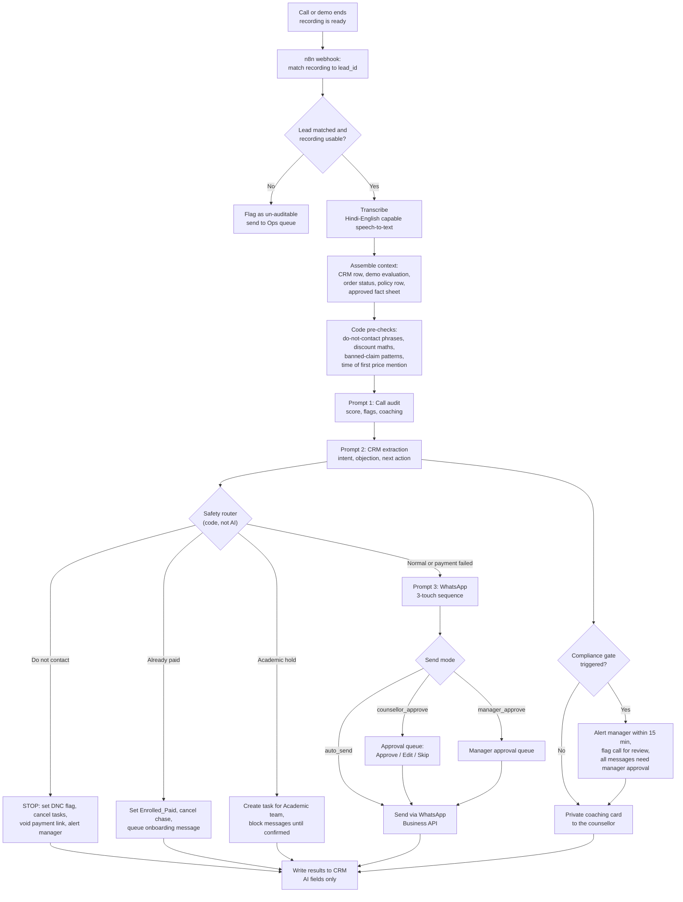
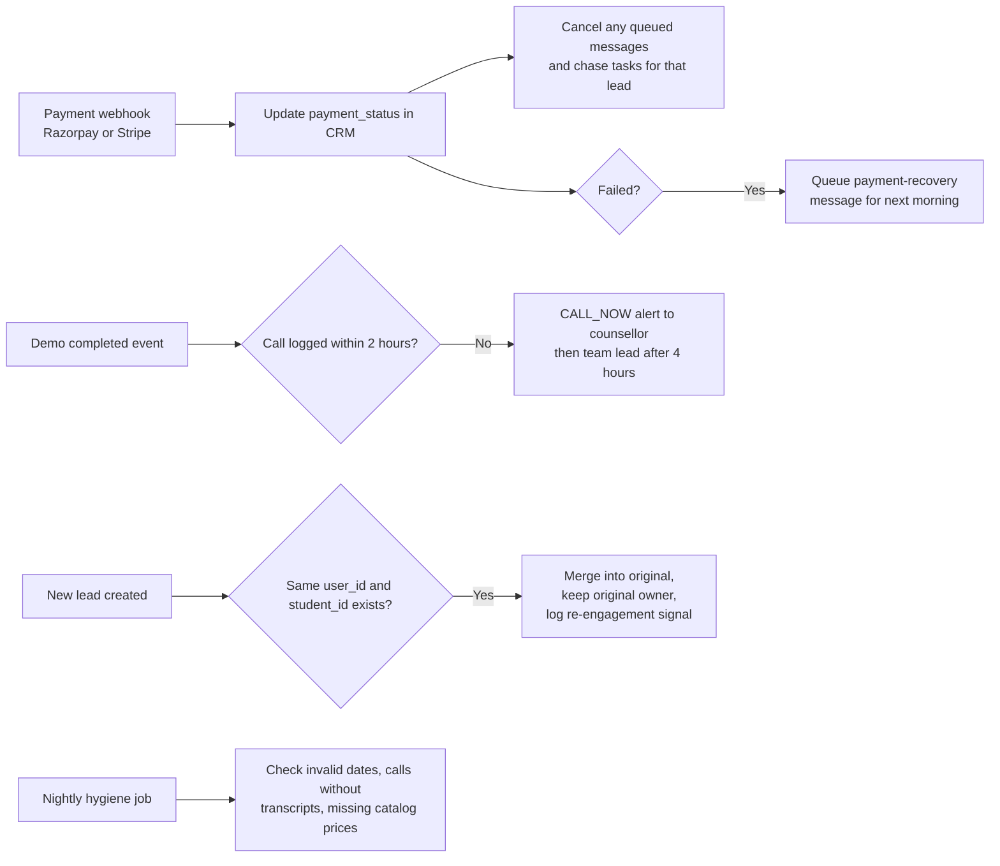

# Stage 5: End-to-End Workflow, Guardrails & No-Code Architecture (Deliverable B)

## 1. Design principles

1. **Code enforces the rules; AI exercises judgement.** Payment status, do-not-contact, discount maths, send windows and banned words are checked by deterministic code. The AI audits, classifies and writes. A prompt alone is never the only safeguard for a critical rule.
2. **Silence is a valid output.** Many leads must not be messaged (803 asked not to be contacted; 804 already paid; 806 is waiting on Academic).
3. **Humans approve persuasion.** Only transactional messages auto-send.
4. **Every AI output carries evidence** (timestamped quotes) so a rep or manager can verify it in seconds.
5. **Coach first, police second.** The rep sees private coaching before any manager sees a score.

---

## 2. Pipeline map (post-call flow)

### Always-on watchers (not triggered by a call)

### What the watchers fix (from the Stage 1 audit)

| Leak in the data | Control that closes it |
|---|---|
| 804 paid but CRM still chasing | Payment webhook cancels chase and sets `Enrolled_Paid` |
| 805 and 809 failed payments, follow-up days away | Payment webhook queues next-morning recovery |
| 807 and 812 high-intent demos never called | Demo-completed watcher alerts within 2 hours |
| 811 duplicate of 801 given to another rep | Duplicate check on lead creation |
| 810 follow-up date before the call | Nightly hygiene job |
| 808, 809, 810 calls with no transcript | Un-auditable flag plus recording-coverage KPI |
| 803 rep created a Rs 5,500 link for a Rs 9,500 course | Payment-link generator enforces the policy cap (see section 4) |

---

## 3. Guardrails: who can send what

| Action | Mode | Why | Example from the data |
|---|---|---|---|
| Write AI fields to CRM (intent, objection, clean note, next action) | **Auto** | Reversible; the rep's original note is never overwritten, only shown beside the AI version | All 12 leads |
| Move stage to `Enrolled_Paid` | **Auto** | Comes from payment-gateway fact, not AI judgement | 804 |
| Private coaching card to the rep | **Auto** | No customer impact | All 6 calls |
| Payment-recovery message, Day 0, for an amount the parent already agreed | **Auto** | Transactional, no new offer | 805 |
| Onboarding message after payment | **Auto**, once the Ops fields (first class date) are filled | Transactional | 804 |
| Any persuasive follow-up (value recap, objection answer, check-in) | **Counsellor approves** (one tap: Approve / Edit / Skip) | Tone and context need a human; the rep may know something the AI does not | 801, 805 touches 2 and 3 |
| Any message mentioning a discount, installment or bridge session | **Counsellor approves**, and code checks it against the allowed offers | Prevents invented offers | 805 |
| Any message on a lead where the compliance gate fired | **Manager approves** | The rep's credibility is already damaged | 802, 806 |
| Message waiting on another team | **Blocked** until the condition is met | Prevents promising what Ops has not confirmed | 806 |
| Any outreach to a do-not-contact parent | **Blocked at three layers** (CRM flag, n8n branch, WhatsApp suppression list) | One missed layer must not cause a breach | 803 |
| Rep-quoted discount above 10% | **Blocked in the payment-link tool** (needs a Team Lead code) | Prevention beats detection | 803 |

**If an approval is not given:** the message escalates to the team lead after 2 hours. It **never** auto-sends. Silence from a human is not consent.

---

## 4. Compliance red flags and how each is caught

| Red flag | Severity | Detection | Who is alerted |
|---|---|---|---|
| Guaranteed outcome or rank ("Rank 1", "100% guaranteed") | Critical | Regex pre-screen, then AI confirms from context | Manager, 15 min |
| Refund promise beyond the 14-day policy | Critical | Regex ("refund" plus time words), then AI confirms | Manager, 15 min |
| Discount above 10% or without a Team Lead code | Critical | **Code**: compare `discount_applied` to the policy cap; also AI reads the call | Manager, 15 min |
| Threat or false scarcity about a child's account or seat ("blacklist") | Critical | Regex plus AI | Manager, 15 min |
| "Off the record" or advice to ignore policy | Critical | Regex plus AI | Manager, 15 min |
| Claiming 1-on-1 for a group plan | Critical | AI | Manager, 15 min |
| Rude or dismissive language to parent or child | Critical | AI (language-aware, so Hinglish is not misread) | Manager, 15 min |
| Price dumped before method (Maths, class 205) | Critical per policy | **Code**: timestamp of first price mention under 2 minutes, plus AI checks no method was explained | Manager, 15 min |
| Standard batch pushed after a 5-6 year old was overwhelmed (Chess, class 401) | Critical per policy | AI reads the evaluation and call together | Manager, 15 min |
| Rep reading the checklist aloud to game the score | Coaching | AI (`gaming_detected`) | Team lead, weekly |
| Refund stated without conditions; unverifiable claims | Minor | AI (`PARTIAL` / `UNVERIFIED`) | Rep coaching card only |

**Critical flags are never auto-closed.** A manager marks each one `confirmed`, `false positive` or `retrained`. False-positive rate is a tracked metric (section 8).

---

## 5. Compliance and platform constraints to confirm before go-live

These are design constraints I would verify with Legal and the WhatsApp provider. I am not a lawyer, and rules change.

- **Recording consent.** Announce recording at the start of every call. Some US states (California, where LEAD-804 is located) require consent from all parties.
- **Personal data.** India (DPDP Act 2023), UK (UK GDPR) and the UAE (PDPL) each have consent and storage rules. Minimise what is sent to the AI (no card or UPI details; mask where possible), sign a data-processing agreement with the AI vendor, and set a retention period for transcripts.
- **WhatsApp templates and opt-in.** Business-initiated WhatsApp messages generally need parent opt-in, and outside the 24-hour reply window they must use pre-approved templates. The system therefore generates **template variables** (child's first name, demo highlight, one-line answer) that fill approved templates. Confirm the current rules with the provider.
- **Quiet hours.** Send only between 09:00 and 20:00 in the parent's local time. CRM timestamps are stored in local time and must be normalized.
- **Suppression list.** A parent who says stop is added permanently, even if the CRM record is later edited.

---

## 6. No-code tool stack

| Layer | Prototype option | Production option | Notes |
|---|---|---|---|
| Recording source | Zoom cloud recording webhook | Telephony provider (Exotel, Knowlarity or similar) | Needs a consistent `lead_id` link |
| Transcription | Whisper API | Deepgram or AssemblyAI | **Must handle Hindi-English mixing.** Test on call 05 first |
| Orchestration | n8n (cloud or self-hosted) | n8n or Make | Three workflows (section 7) |
| CRM / data | Google Sheet (tabs in section 9) | Bambinos' existing CRM via API | Sheet is the prototype; CRM is the system of record |
| AI | Claude API, temperature 0 for Prompts 1 and 2 | Same, with a model-version pin | JSON schema validation node after every call |
| Messaging | WhatsApp Business via a provider (Gupshup, Interakt, WATI or Twilio) | Same | Template approval takes days: start early |
| Approvals | Slack interactive message, or a Sheet checkbox | Slack or CRM task | One tap to Approve / Edit / Skip |
| Payments | Razorpay and Stripe webhooks | Same | Source of truth for `payment_status` |
| Dashboard | Looker Studio on the Sheet | Same | Manager and rep views (section 8) |

---

## 7. n8n workflow specification

### Workflow 1: Post-call pipeline
| # | Node | Type | What it does | If it fails |
|---|---|---|---|---|
| 1 | Recording ready | Webhook | Receives recording URL, call id, phone, counsellor id | Retry from provider |
| 2 | Match lead | Sheet/CRM lookup | Finds `lead_id` by phone and time window | Ops queue: "unmatched call" |
| 3 | Transcribe | HTTP request | Speech-to-text with speaker labels and timestamps | Mark `un-auditable`, alert Ops |
| 4 | Fetch context | CRM / Sheet reads | CRM row, evaluation, order, policy row, fact sheet | Continue with `missing_inputs` listed |
| 5 | Pre-checks | Code | DNC phrases, discount maths, banned patterns, first-price timestamp | Never skipped |
| 6 | Prompt 1 | AI | Call audit JSON | Retry once, then human queue |
| 7 | Validate | Code | JSON schema check; **every quote must appear in the transcript** | Reject output, retry |
| 8 | Prompt 2 | AI | CRM JSON | Same |
| 9 | Safety router | Switch | DNC, paid, academic hold, gate, normal | Default is "do nothing and alert" |
| 10 | Prompt 3 | AI | WhatsApp JSON | Same |
| 11 | Message validator | Code | Word count, banned words, no unknown prices, no unknown links | Reject and retry |
| 12 | Write CRM | Sheet/CRM write | AI fields only, never the rep's original note | Retry, then alert |
| 13 | Coaching card | Slack/email | Private to the rep, strengths first | Log only |
| 14 | Manager alert | Slack | Only if gate or DNC triggered | Page backup manager |
| 15 | Approval queue | Slack buttons | Approve / Edit / Skip | Escalate after 2 hours |
| 16 | Send | WhatsApp API | Template with variables, inside the send window | Retry, log delivery status |

### Workflow 2: Payment events
Webhook from the gateway, then update `payment_status`, then cancel queued messages and chase tasks, then branch: **paid** triggers onboarding; **failed** queues recovery for 09:00 next day in the parent's local time.

### Workflow 3: Watchers and nightly hygiene
Demo-completed with no call after 2 hours alerts the counsellor, then the team lead after 4 hours. New-lead duplicate check. Nightly checks for invalid dates, calls with no transcript, and classes or currencies missing from the pricing table.

---

## 8. SLAs and health metrics

| Event | Target |
|---|---|
| Call ends to CRM updated | within 10 minutes |
| Critical compliance flag to manager | within 15 minutes |
| Demo completed with no call to alert | within 2 hours |
| Payment failure to recovery message | next morning, 09:00 local |
| Approval queue | within 2 hours, then escalate |

| Metric | Why it matters |
|---|---|
| Audit coverage (calls scored / calls made) | Moves from 2% to 100% |
| Un-auditable call rate | Exposes recording gaps (808, 809, 810) |
| Critical-flag false-positive rate | Keeps trust in the system |
| Rep edit rate on drafts | Measures message quality |
| Approval turnaround | Measures friction |
| Demo-to-call time | Finds leaks like 807 and 812 |
| Payment-recovery rate | Direct revenue impact |
| Rep NPS on the coaching cards | Adoption |

**Regression test:** the 6 sample calls are kept as a fixed test set. Before any prompt or model change, re-run them. The expected bands are in the scorecard document (801, 804, 805 should score 75-92 with no gate; 802, 803, 806 should be gated and at most 40). If results move outside the band, the change is not shipped.

---

## 9. Google Sheet prototype structure

| Tab | Columns (summary) |
|---|---|
| `Leads` | The 12 CRM rows plus AI fields: intent label and score, primary objection, status, demo highlight, payment status, recommended stage, next action, owner, due time |
| `Call_Audits` | One row per call: 7 criterion ratings, raw and final score, gate, gaming flag, band |
| `Flags` | One row per compliance flag: lead, severity, timestamp, quote, rule, manager decision |
| `Approval_Queue` | One row per message: lead, touch, text, send mode, status (pending / approved / sent / skipped / blocked) |
| `Suppression_List` | `lead_id`, reason, quote, date, set by (never deleted) |

---

## 10. Failure modes and fallbacks

| Failure | Fallback |
|---|---|
| Transcript is wrong (accent, Hinglish) | Quotes will not match; validator rejects; call goes to human review |
| AI returns invalid JSON | Retry once, then human queue |
| Call matched to the wrong lead | Phone and time-window match; low-confidence matches go to Ops |
| Payment event arrives after a message is queued | Webhook cancels queued messages first |
| AI misreads sarcasm or a joke as a threat | Manager confirms before any penalty; false positives are tracked |
| AI confidently invents a fact | Messages may use only facts from the inputs; validator rejects unknown prices, dates and links |
| Model update changes behaviour | Regression test on the 6 calls before any change |
| Anything unexpected | Kill switch: one toggle pauses all sending but keeps auditing |

---

## 11. Rollout dependency: the approved fact sheet

Many claims in the sample calls were marked `UNVERIFIED` only because the data has no batch roster, curriculum document, or feature list. The cheapest accuracy upgrade is a short **approved fact sheet** (current batches and seat counts, features such as exam pause, credentials, refund wording, prices for all classes and currencies). The AI then checks claims against it, and reps get one place to find the truth.
